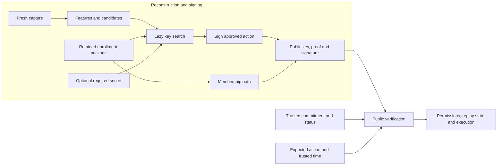

# Architecture

Gnorix separates biometric reconstruction from public verification and application authority. This page describes those mechanism boundaries; [Development](development.md) covers the Rust workspace and package layout.

## Measurement and candidate construction

The measurement stage turns an image into ridge scale, contours and ranked features. The native fingerprint implementation processes one capture at a time; it does not merge repeated impressions or implement sensor acquisition.

The candidate stage selects spatially admissible feature combinations and gives each combination a canonical integer-grid representation. Normalization is per combination, using its hull, measured R and grid phase. It is distinct from registering or elastically aligning full images.

The generic `MeasurementEngine` interface lets an application provide its own measurement model and candidate stream. The native fingerprint components expose their own analysis, combination and grid stages. Both paths use the same core enrollment and signing machinery.

## Enrollment and retained material

Enrollment binds candidate interpretation, cryptographic suite, domain, subject, revision, salt and secret policy. The chosen `CryptoProvider` derives candidate keys; context-bound public-key hashes form a deterministic Merkle commitment.

Generic `MeasurementEngine` enrollment retains its reconstruction model and hash tree. The native fingerprint path supplies encoded candidates directly, with no engine model; its `.grx` package retains public context, reconstruction settings and leaf hashes needed to rebuild the tree. Transient private keys are not retained as a key list. Storage protection, backups and recovery authority belong to the application.

The commitment must enter the verifier's registry through an authorized enrollment operation. A root supplied with an arbitrary request cannot replace that trusted state.

## Reconstruction, signing and verification

Reconstruction tries one candidate at a time against the retained tree, stopping at the first member. In the native fingerprint path, enrollment commits keys derived from baseline positions; signing searches permitted positional neighborhoods for a matching key. Profile and resource checks prevent silent changes to that interpretation.

Signing binds the matching key to the exact approved action. Public verification checks its membership and signature against trusted enrollment state and the expected action. `SignatureVerifier` is narrower than `CryptoProvider`: verification requires neither biometric extraction nor private-key derivation.

Raw captures and the complete enrolled key set are unnecessary for verification. Processing location is an application choice: the provided web demos process bundled test images in a Rust backend. This separation does not imply that biometric processing always happens on a user's device.

## Application and NEAR boundaries

Applications control enrollment ownership, exact payload semantics, consent, permissions, durable replay state, revocation and recovery. Core verification returns evidence; it grants no unrestricted account access and performs no protected operation.

The optional NEAR integration implements contract-side commitment lifecycle and authorization checks using the actual chain and contract context. The smart-wallet example applies those checks before calling a separate standard token contract. A token transfer is asynchronous: nonce consumption, pending execution and final settlement remain distinct steps. An uncertain submission must be reconciled before another transfer is allowed.

The web demonstration uses one shared sandbox with isolated, expiring browser sessions. Each session owns separate wallet/token accounts and enrollments; immutable fingerprint preparation is shared. These deployment choices belong to the [example](../examples/near/README.md), not the core signing protocol.

## Compatibility and evidence

Changes to feature interpretation, grid encoding, key derivation or enrollment context can change derived keys and require authorized re-enrollment. These are prerelease formats without a legacy compatibility promise.

Protocol correctness and biometric reliability are separate: valid membership and signatures do not establish unique identity or a live scan. Current limitations are recorded in the [biometric security boundary](near-sdk.md#biometric-security-boundary). See [How it works](how-it-works.md) for the complete implemented flow.
