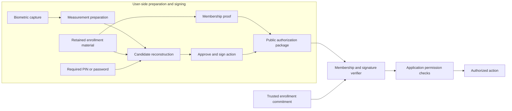

# Architecture

Gnorix is organized around an independent biometric-cryptographic library and separate application integrations. The library connects biometric measurements, candidate signing keys and membership proofs. An integration decides how an enrollment is owned, how authorizations are accepted and what actions they may permit.

This separation avoids making a blockchain responsible for processing raw biometric images or treating the signing mechanism as exclusive to one account system.

## The independent library

### Capture preparation and measurement

The preparation component obtains usable measurement information from repeated captures, aligns them and identifies usable coverage. It separates global translation or rotation from missing and uncertain local observations. Its responsibility is a comparable representation, not an assertion that every acquisition is authentic or live.

### Enrollment construction

The enrollment component describes accepted measurement variations and derives their candidate verification keys. It creates the Merkle commitment representing that set and the associated information needed to find membership paths later.

Enrollment policy is part of the authorization identity. Changing how measurements are interpreted can change which keys are accepted, so it cannot be treated as an invisible update to an existing enrollment.

### Candidate reconstruction and signing

The reconstruction component processes a later capture with the required enrollment information and optional secret. Its goal is to recover one enrolled candidate, not to recreate every enrollment possibility during each signing operation.

The signing component binds that key to the action the person approves. It must preserve the distinction between recovering a key and obtaining permission to use it for a particular request.

### Membership evidence and verification

The proof component finds the path connecting the candidate public key to the enrollment's Merkle root. The verifier checks that relationship and checks the action signature with the candidate public key.

These checks are complementary. A membership path without an action signature does not prove authorization of an action. A valid signature from an unrelated key does not establish membership in the enrollment. The root commits to the accepted set but is not itself the ordinary signature verification key.

## User-controlled material and the verification boundary

Raw captures and the full candidate set are not required inputs to public verification. The user-side process retains the material needed for reconstruction and proof generation under an appropriate access and backup policy. A verifier receives the candidate public key, membership evidence, signature and relevant action context.

This boundary reduces the information needed for verification; it does not establish complete anonymity or protection from a compromised device. Disclosed keys and proof material can have privacy consequences even when a raw image is never published.

The application must obtain its enrollment commitment from a trusted registration process. Accepting a requester's arbitrary replacement root would defeat the intended ownership boundary.

The same boundary in words: biometric processing and proof preparation happen on the user side; the application verifies the resulting authorization against its trusted enrollment and its own rules. The optional-secret requirement depends on the enrollment policy.

## Application responsibilities

Applications own registration authority, supported operations, permission limits, freshness, revocation and recovery. They must distinguish a valid signature from permission to perform an unlimited action. They also determine how consent is presented and how an interrupted request is resumed or rejected.

The library does not by itself establish civil identity, unique-person status, a live sensor reading or the integrity of the screen on which an action was approved. Those requirements need additional application controls when relevant.

## NEAR integration

NEAR is an integration for registering commitments and checking signatures before protected on-chain operations. It is separate from the independent library: raw biometric extraction and candidate generation are not assumed to run on chain.

An application can verify signed data or enforce a bounded authorization on resources already under its control. For example, an owner can permit spending within a limit; a correctly signed request beyond that limit must still be rejected. A signature does not confer access to assets held in unrelated accounts.

When execution continues through asynchronous calls, verifying an authorization is not equivalent to completing its action. The integration must distinguish pending, successful and failed outcomes, prevent duplicate execution and avoid restoring authority while an outcome remains uncertain. Exact operational contracts belong to the integration's design rather than the library's biometric model.

## Lifecycle and continuity

The enrollment, its retained material and the verifier's commitment must remain compatible. Changing measurement policy, an additional secret or the accepted key set can require authorized re-enrollment or root replacement.

Ordinary signing, revocation and recovery may have different authority requirements. A retained backup is one continuity option, but its confidentiality and integrity must be protected. Reconstructing one key from a fresh scan does not guarantee recovery of the old commitment and all its proof material.

See [concept](concept.md) for the core principle and [how it works](how-it-works.md) for the full lifecycle.
