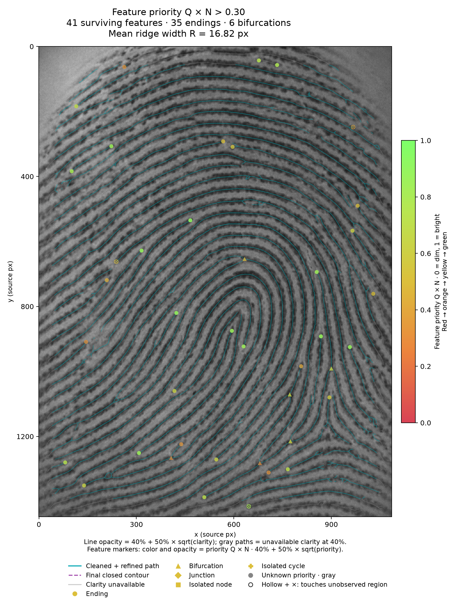

# Fingerprint extraction

`gnorix::core::biometrics::fingerprint` turns a grayscale `Capture` into measured ridge structure and ranked feature candidates. Processing is native Rust and local; it does not call Python, a scanner SDK or a network service. Source pixels, coordinates and extracted measurements are sensitive biometric data.

## Feature summary

The extractor records **endings, bifurcations, other junctions, isolated nodes and isolated cycles**. Each original candidate has an ID, source-image position, graph references, evidence scores, coverage, stop reasons and stress-test correspondences. A bifurcation has three incident arms; higher-degree junctions remain distinct.

The common geometric unit **R** is the length-weighted mean dark-ridge thickness. It scales cleanup, contour reconstruction and feature assessment. Ridge period, including the light gap, is measured separately.

There are two entry points, sharing the same analysis:

| API | Result and use |
| --- | --- |
| `analyze(&capture, &config)` | `FingerprintFeatures`: dimensions, R, confirmed-pattern bounds and type-preserved candidates surviving cleanup/reconstruction. Used by enrollment and signing. |
| `extract(&capture, &config)` | `Fingerprint`: all intermediate rasters, observed/reconstructed graphs, source measurements, clarity maps and candidate diagnostics. Used by reports. |

`analyze` skips report-only clarity maps and curve descriptors, but still performs the full width pass, contour reconstruction and eight stress cases. It releases the diagnostic rasters and graphs before returning. `Fingerprint::features()` projects the full result into the same compact representation. Unknown priority is `None`, not measured zero; scores from a removed or reclassified feature are not assigned to its replacement.

### Example: priority above 30%



This saved illustration uses the [synthetic test fixture](../crates/core/tests/assets/README.md) and filters surviving candidates to `priority > 0.30`. Circles mark endings and triangles mark bifurcations. Red → orange → yellow → bright green indicates increasing priority; hollow × markers retain uncertain continuation. The cutoff belongs to this illustration, not to extraction. Regenerate the report to inspect the current implementation rather than treating this snapshot as a benchmark.

## Run on an image

From the repository root:

```sh
uv run --project tools/fingerprint-reports --locked gnorix-report \
  --image crates/core/tests/assets/test-fingerprint.png
```

The command runs the Rust extractor and writes nine PNG figures plus native measurements under `reports/fingerprint/`. See the [report tool](../tools/fingerprint-reports/README.md) for requirements, display controls and refresh boundaries, or the [SOCOFing testing guide](fingerprint-testing.md) for external inputs.

The PNG example rejects transparency. Applications with missing source pixels should use `Capture`'s validity mask; replacing unknown pixels with black invents evidence. The core API accepts decoded grayscale pixels. Image decoding and JSON export are example dependencies, not runtime requirements of the extraction API.

## Processing stages

[The pipeline](../crates/core/src/biometrics/fingerprint/pipeline.rs) composes these stages:

1. **Bootstrap:** find repeated dark/light profiles and estimate a provisional ridge period.
2. **Source preparation:** compute local dark/light references and an orientation field once, sharing them with measurement and enhancement.
3. **Full width measurement:** trace a raw adaptive dark mask and measure all supported ridge links to obtain R.
4. **Enhancement and tracing:** normalize, denoise, apply directional contrast filtering, thin and trace the observed graph.
5. **Reconstruction:** remove source-confirmed artifacts, constrain contour smoothing and join supported short gaps.
6. **Assessment:** rank original candidates from source evidence, geometry, wider context and threshold repeatability; project surviving candidates for downstream use.

Full extraction additionally describes curves and computes an independent clarity map. Neither clarity nor a low candidate rank changes the preceding topology.

`ExtractionConfig` defaults are `min_contrast = 0.035` (local grayscale standard deviation divided by 255), `min_coherence = 0.2`, `max_pixels = 4_000_000` and `bootstrap_grid_locations = 4096`. These are processing controls, separate from combination/signing tolerances. The bootstrap location count bounds its initial grid, not the exhaustive fallback or full width traversal. Unsupported scale or exhausted work limits return an explicit error; no sample-specific R is substituted.

## Full-source measurement and common unit

The bootstrap searches deterministic transverse profiles containing three complete dark ridges separated by light valleys. If the initial grid finds no support, it searches source sites exhaustively. Width boundaries use subpixel half-contrast crossings; clipped ridges and invalid mask crossings cannot provide complete widths. Independent medians of ridge width, valley width and center-to-center period initialize processing and remain diagnostics; they do not determine final R.

The full measurement pass thins a raw mask formed from original grayscale and local dark/light references, before the final denoising/directional filter. It visits every unique undirected skeleton link, including junction-cluster and closing-cycle links. Each link represents one pixel of length, or `sqrt(2)` diagonally. The local orientation field supplies its normal; only the dark span containing its midpoint can contribute a width.

A complete three-ridge profile confirms a local ribbon of pattern support. The union of those ribbons is clipped by acquisition validity; it does not flood an entire connected component. Inside confirmed support, a measurable ridge section may contribute without independently seeing three complete neighbors. Both link endpoints and the measured source span must be supported.

```text
R = sum(own_ridge_width_px × represented_length_px) / sum(represented_length_px)
length_in_units = source_length_px / R
```

Equal portions of measured ridge length therefore have equal weight. Neighboring ridges confirm context rather than adding repeated width votes. No median, dominant-mode selection or width trimming replaces this mean. Coverage records traversed versus measured links/length and isolated pixels; missing boundaries or normals remain unmeasured. Complete traversal does not mean that every physical ridge was observable.

Width-consistency diagnostics count observations within ±10%, ±20% and ±30% of R. The bootstrap separately retains arithmetic means, medians and deviations for ridge/gap widths, plus original grayscale brightness over confirmed dark spans and intervening light gaps. Brightness uses `0 = black`, `255 = white`, weighted by span length; it is not physical color temperature. These cross-section statistics can revisit the same physical ridge.

## Normalization, enhancement and graph geometry

Overlapping windows of radius `ceil(bootstrap_period / 2)` estimate masked local mean/variance. Pixels below or above their local mean seed dark or light classes. The original grayscale means of these classes give local references D and L. A supported location requires both classes, sufficient contrast and D < L.

```text
normalized_intensity = clamp((I - (D + L) / 2) / ((L - D) / 2), -3, 3)
```

Thus D maps to −1 and L to +1. The same absolute brightness can be dark in one zone and light in another. Unsupported references remain masked, not borrowed from another zone. Palette support is normalization evidence, not anatomical segmentation.

Orientation/coherence comes from gradient tensors of the first-pass standardized image. Detection uses palette-normalized intensity, Gaussian denoising with sigma `bootstrap_period / 20`, and a three-line directional contrast filter. This is not a Gabor filter or an exact SourceAFIS port.

Zhang–Suen thinning includes component-preservation and clipped-boundary provenance safeguards. Deterministic graph tracing preserves disconnected components and isolated degree-two cycles, merges acyclic junction clusters and suppresses redundant raster links. Genuine holes are retained; a filled 2×2 raster cell is not a hole. Filtering can still alter connectivity, so this graph is observed processing output, not verified anatomy.

Full diagnostics measure path arc length, endpoint distance, half-length position and tangent-turning profiles. Observed descriptors sample at R/4 with Gaussian sigma R/2; reconstructed descriptors use the already smoothed paths. A half-length position is not a fitted circle center. Junction representative positions can differ from the actual ports where arms leave the cluster. An ending may indicate missing signal rather than a biological ridge termination.

## Source-supported ridge cleanup

Cleanup examines the observed graph once and retains the original graph, decisions and provenance. The ±20% width allowance leaves R unchanged.

| Candidate | Required source confirmation |
| --- | --- |
| Junction-to-ending spur with complete arc length **< 1.2R** | Visible termination without a supported continuation. Acquisition gaps, ambiguous continuation and component-preservation safeguards retain the branch. |
| Two arms splitting and rejoining two degree-three junctions, transverse width **< 1.2R** | Original pixels support one ridge rather than two separated ridges. An interior light valley extending at least **R/3** protects the loop. |

A collapsed loop keeps the source-preferred observed arm; cleanup does not invent a midpoint curve. Strict source checks govern automatic changes. They are separate from the gradual evidence scores used for ranking.

## Contour smoothing and gap reconstruction

Smoothing uses arc-length stations spaced at `min(R/8, 1 px)`, sigma R/2 and displacement bounded by R/4. Endpoints, observed support, crossings, separation and cycle shape constrain the proposal. Backoff reduces displacement when constraints fail; otherwise the original path and a retention reason remain.

Gap repair considers endings at most R apart, with enough incident ridge length to estimate direction and facing angles within 30°. Cubic bridges follow endpoint tangents, bound curvature by `1/R` and keep at least R/4 clearance from unrelated paths. Only mutually unique, nonconflicting partners can join.

Acceptance samples original grayscale relative to D/L, requiring mean darkness ≥0.5, dark-length fraction ≥0.7, mean advantage over flanks ≥0.25 and no sampled light run longer than R/4. Flanks are 3R/4 away. Every crossed source interpolation cell must be observed and have palette support. Geometric plausibility alone does not authorize a join; unsupported, unobserved, ambiguous or obstructed proposals remain diagnostic alternatives.

## Feature strength, scale context and priority

Every original candidate is assessed independently of cleanup. The compact result and main report expose surviving, type-preserved features; the diagnostic report retains removed and uncertain candidates too.

| Component | Evidence |
| --- | --- |
| P | Local original-image support: ridge continuity and feature-specific separation/termination. |
| G | Local geometry, with required arms followed over up to 2R. |
| C | Extended source-confirmed structure over up to 4R; 2R context is retained for comparison. |
| T | Fraction of eight threshold variants preserving a corresponding candidate. |
| N | Neighborhood factor within radius 3R, accounting for crowding and available source coverage. |

Context follows sustained ridge/flank separation and continuity, including source-confirmed continuation across incidental graph nodes. Short or unsupported arms weaken a feature. Forks need separated departing arms; a strong trunk cannot replace that evidence. Ending context considers the strongest graded light cap in the allowed lookahead and weakens when forward or curved continuation is supported. Uneven contrast reduces evidence gradually; one dark corner is not a categorical rejection. Required but unobserved context stays unknown.

Stress tests reuse the source preparation and R. They re-binarize, thin and trace eight combinations of directional margins `−0.05, 0, +0.05` and coherence thresholds around the configured value, excluding the baseline. At defaults, coherence levels are `0.18, 0.20, 0.22`. Correspondence is one-to-one and checks type, position and arm/cycle geometry, not just nearby pixels. This measures sensitivity on the same capture, not repeat-scan reliability.

```text
Q = C × (0.75 + 0.25 × min(P, G)) × (0.5 + 0.5 × T)
weighted_count = sum((1 - distance / (3R))²) over other candidates within 3R
N = 0.5 + 0.5 × observed_fraction / (1 + weighted_count)
priority = Q × N
```

Extended context is the main evidence. Local support can attenuate it by up to 25%, and stress stability by up to 50%. N stays within 0.5–1 and counts all original candidates, including later-removed artifacts. Isolation cannot create strong evidence; crowding changes priority rather than intrinsic strength Q. Pixels outside the frame or validity mask reduce `observed_fraction`.

Missing required evidence produces unknown Q/priority, distinct from a measured zero. These scores are **engineering ranks, not calibrated recognition probabilities**. Candidate-level measurements and policy definitions live in [features.rs](../crates/core/src/biometrics/fingerprint/features.rs) and its submodules.

## Local clarity diagnostics

Full extraction evaluates original-image patches oriented across ridges. It removes a local illumination trend and measures contrast, dark/light class separation and repetition near the bootstrap period. Anchor clarity is the product of these three components, then bilinearly interpolated. The component maps interpolate independently, so their dense pixelwise product is not the dense clarity map.

Explicit support distinguishes missing evidence from zero clarity. Path-segment values integrate the map along each segment; an unsupported segment is `null`. Open paths have one value per consecutive point pair; cycles also include their closing segment. Clarity controls diagnostic line visibility only. It neither gates extraction nor enters feature Q directly; the supported-pixel mean is not an overall fingerprint accuracy score.

## Interpretation and next stages

The next stages form [regional combinations](feature-combinations.md), normalize them to [integer grid figures](grid-shapes.md), and derive [enrollment packages](grx-packages.md) for [fresh-capture signing](fingerprint-signing.md). Successful signature/Merkle verification establishes key membership and message validity, not biometric identity. The current geometric descriptor has a demonstrated cross-subject collision; see the [signing limitations](fingerprint-signing.md).

Normalization/orientation follows established enhancement ideas, including [Hong, Wan and Jain](https://doi.org/10.1109/34.709565); thinning derives from [Zhang and Suen](https://doi.org/10.1145/357994.358023), with the safeguards described above. These sources do not establish the accuracy of this implementation. Evaluation requires independent repeat captures, subjects and explicit error rates; synthetic fixtures and same-image crops alone cannot provide them.
