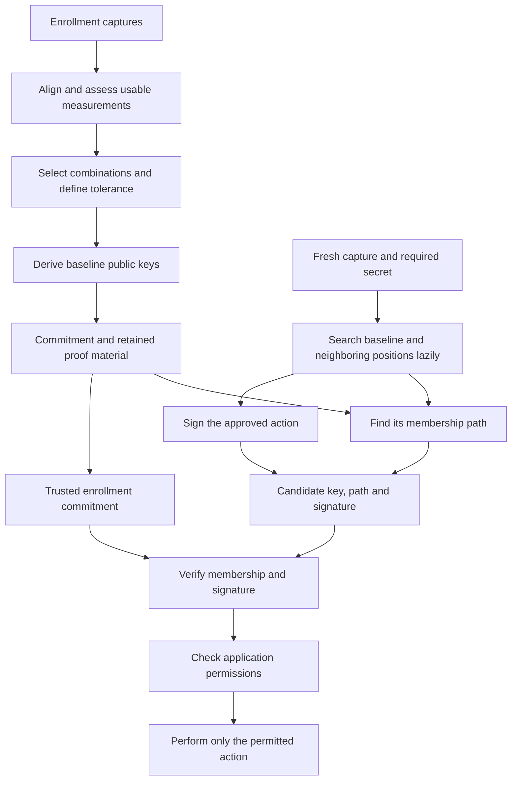

# How it works

Gnorix separates enrollment, later signing and application authorization. Enrollment commits to baseline keys from selected feature combinations. A later capture searches for one of those keys within the configured measurement tolerance. Verification checks both membership and the signature before the application decides whether the action is permitted.

## 1. Capture enough usable biometric information

Enrollment begins with biometric captures that provide enough usable coverage of the selected measurement. Repeated captures help distinguish recurring features from unreliable observations. A poor or incomplete capture can require another attempt rather than being treated as evidence about an unseen area.

The acquisition method must provide the information the library needs. A device's ordinary biometric unlock result is not automatically a reusable fingerprint measurement. Capture choice and the signing mechanism are separate responsibilities.

## 2. Align captures and establish a common representation

The preparation stage brings captures into a comparable frame. A whole image being translated or rotated is different from a particular local feature being missing or uncertain. These effects must not be collapsed into one unrestricted tolerance.

Aligned observations can be combined to describe the usable biometric features and their consistency. Quality controls determine which information is suitable to retain. Alignment and quality settings involve speed, repeatability and coverage tradeoffs; a setting is not automatically a direct measure of cryptographic strength.

If alignment or coverage is inadequate, the process requests another capture or stops. It does not create confidence by silently discarding inconvenient differences.

## 3. Define the accepted variation

Enrollment specifies the feature-selection policy and tolerated measurement differences. These settings define which feature combinations are enrolled and which neighboring positions a later capture may search. The same interpretation must apply when the person signs later.

The goal is not to flatten all measurements into a trivial common value. It is to preserve useful distinctions while accounting for expected variability. Greater tolerance can improve acceptance of genuine recaptures but can also expand the space accepted by the enrollment. The policy must balance these effects.

## 4. Derive candidate signing keys

Each selected feature combination is normalized and rounded to the grid. These baseline positions produce one candidate private key and its corresponding public key. Positional uncertainty is searched during later signing; it does not multiply the enrolled keys. If a PIN or password is part of the enrollment, it contributes as a secret input during both enrollment and later reconstruction.

This additional secret can be simple or strong according to the chosen protection policy. A public salt is not a substitute for it. Neither a long output key nor a large number of candidate keys establishes how difficult the original inputs are to guess.

The candidate private keys are not intended to become a permanent list of stored secrets. The enrollment retains the information needed for the commitment and later membership evidence under a defined protection policy.

## 5. Create the Merkle commitment

The public candidate keys form the leaves of a Merkle tree. Hashes combine those leaves into a single root representing the accepted set. The verifier associates that root with an authorized enrollment.

A Merkle path provides the sibling information needed to connect one candidate public key to the root. This lets verification check one candidate without receiving the entire tree or trying every possible signature key.

The root identifies the accepted set; the candidate public key remains the key used to verify the actual signature. Registering the root must be authorized by the enrollment owner rather than accepted for an arbitrary person or account.

## 6. Retain membership material

The person needs a way to obtain the correct path for a reconstructed key. Retained tree, index or proof material supports this lookup. It is separate from the public commitment and from the fresh biometric reading.

This material is not automatically harmless because it omits raw images or private keys. Its handling, backup and recovery matter. Losing it can prevent an otherwise valid reconstructed key from being used with the existing enrollment.

## 7. Reconstruct one candidate from a fresh capture

When signing, the person supplies another capture and any required additional secret. The library applies the enrollment's measurement interpretation and visits feature combinations in deterministic priority order. It first tests a combination's rounded baseline, then lazily tries its neighboring-position combinations in the same fixed grid frame. Each derived key is checked against the enrolled set immediately. A match stops the search; only after exhausting that combination's positional variations does the search move to a lower-priority combination.

The result need not equal the single reading used as an enrollment reference. It must belong to the set already committed by that enrollment. If no candidate is found, the system follows its retry or recovery policy; it does not silently enlarge the enrolled set to make the request pass.

## 8. Approve and sign the exact action

The person reviews the data or operation to authorize. The reconstructed private key signs that intended content, including the context needed to prevent it from being repurposed elsewhere.

For an operation, the authorization must distinguish the relevant application, enrollment and consequential parameters. A signature intended for one recipient or amount must not become approval for another. Where authorization is one-time or time-limited, the application also needs an appropriate freshness and reuse policy.

The resulting package includes the candidate public key, its Merkle path and the action signature. Raw biometric captures and all other enrolled public keys are not required for this verification step.

## 9. Verify membership, signature and permissions

The verifier first uses the trusted enrollment commitment, not a replacement supplied by an untrusted requester. It checks that the candidate belongs to the enrolled set and that its signature matches the intended action.

The application separately checks whether the enrollment is active, the authorization is still usable and the action is within the owner's permissions. A cryptographically valid package can therefore be rejected because its permitted use has expired or because the action exceeds an allowance.

In the NEAR integration, protected actions concern only resources the application is authorized to control. When an action spans asynchronous operations, acceptance, completion and failure are distinct outcomes. Retrying must not accidentally execute the same authorization twice.

## 10. Handle failure, change and recovery

A poor capture can be repeated under the existing enrollment rules. Changing those rules, the additional secret or the enrolled set is a different operation and can require a new commitment and explicit authorization.

Recovery from lost proof material, replacement of a root and revocation after compromise need their own authority. A fresh scan does not guarantee reconstruction of the old root or its complete proof data. Recreating an enrollment and restoring an existing one are different outcomes.

A stronger recovery secret may be used separately from a secret intended for limited everyday actions. The appropriate relationship between these protections must account for shared biometric and device failures rather than assuming that two labels create two independent factors.

## The complete flow

The diagram separates enrollment from later signing and shows the two inputs needed for verification: a trusted commitment and a newly created authorization package.

In words: prepare an enrollment, retain its proof material, reconstruct one enrolled key later, sign the requested action, and check both cryptographic evidence and application authority. See [architecture](architecture.md) for responsibility boundaries.
